# AuraMIDI

A computer-vision-based musical performance controller that transforms physical object movement in front of a webcam into live MIDI triggers for digital audio workstations.

AuraMIDI tracks a colored physical object (such as a highlighter, pen cap, or colored marker) across a video feed, maps its coordinates to a virtual control grid, and transmits MIDI messages through a virtual MIDI port into **FL Studio**, mimicking the layout of a **Novation Launchpad MK2** in Performance Mode.

---

## Table of Contents

- [Features](#features)
- [How It Works](#how-it-works)
  - [Signal Flow](#signal-flow)
  - [Screen Layout and Control Matrix](#screen-layout-and-control-matrix)
  - [MIDI Mapping Logic](#midi-mapping-logic)
- [Prerequisites](#prerequisites)
- [Building with Visual Studio](#building-with-visual-studio)
- [Configuration](#configuration)
  - [HSV Threshold Format](#hsv-threshold-format)
  - [Live Tuning with Trackbars](#live-tuning-with-trackbars)
- [MIDI Setup and FL Studio Integration](#midi-setup-and-fl-studio-integration)
- [Usage](#usage)
- [Troubleshooting](#troubleshooting)
- [Dependencies](#dependencies)
- [Limitations and Future Improvements](#limitations-and-future-improvements)

---

## Features

- **Real-Time Video Capture**: Captures live frames at low latency using OpenCV (`cv::VideoCapture`).
- **Color-Based Object Tracking**: Segments objects in the HSV color space with morphological filtering (Opening and Dilation) to reject noise.
- **Centroid & Enclosing Circle Detection**: Identifies the largest colored contour and calculates its minimum enclosing circle with visual feedback.
- **Interactive On-Screen Grid**: Features a 4-track selection strip and a 4-pattern + Mute trigger bar drawn directly onto the mirrored video feed.
- **Debounced Trigger State**: Ensures clean, single-note triggering when an object enters a zone, preventing unwanted repeat triggers while hovering.
- **RtMidi Integration**: Directly outputs standards-compliant MIDI Channel 1 Note On/Off messages with interactive port selection on launch.
- **Live HSV Calibration**: Displays an interactive trackbar window (`"Set HSV"`) alongside the thresholded binary mask (`"Display Mask"`) for real-time calibration under varying lighting conditions.
- **Persistent Configuration**: Loads initial threshold values from `assets/object.json` on startup.

---

## How It Works

### Signal Flow

```mermaid
flowchart LR
    A["Webcam Feed<br/>(Camera Index 0)"] --> B["OpenCV Preprocessing<br/>(Flip & BGR-to-HSV)"]
    B --> C["Color Segmentation<br/>(inRange & Morphology)"]
    C --> D["Contour Extraction<br/>(Largest Area Blob)"]
    D --> E["Coordinate Mapping<br/>(Track & Pattern Zones)"]
    E --> F["RtMidiOut<br/>(Note On / Note Off)"]
    F --> G["LoopMIDI<br/>(Virtual MIDI Cable)"]
    G --> H["FL Studio<br/>(Launchpad MK2 Controller)"]
    H --> I["Playlist Performance Mode<br/>(Clip Launch / Track Mute)"]
```



> **Important distinction regarding LoopMIDI**: LoopMIDI serves purely as a virtual MIDI cable transporting raw MIDI byte streams between processes on Windows. It does **not** emulate physical Launchpad hardware. The controller identity, button mappings, and Performance Mode behavior are handled entirely inside FL Studio by setting the MIDI input port's controller type to **Novation Launchpad MK2**.

---

### Screen Layout and Control Matrix

AuraMIDI mirrors the video feed horizontally so that moving your hand left or right matches natural physical motion on screen. The interface divides the frame into distinct interactive zones:

```
(0,0)                                                     (640,0)
  +-----------+-----------+-----------+-----------+-----------+
  |   PAT 1   |   PAT 2   |   PAT 3   |   PAT 4   |   MUTE    |  <-- Patterns Row (y: 1 to 80)
  | (80..160) |(175..255) |(270..350) |(365..445) |(460..540) |
  +-----------+-----------+-----------+-----------+-----------+
  |  TRACK 1  |
  | (80..160) |
  +-----------+
  |  TRACK 2  |
  |(175..255) |
  +-----------+
  |  TRACK 3  |
  |(270..350) |
  +-----------+
  |  TRACK 4  |
  |(365..445) |
  +-----------+
  ^
  Tracks Column (x: 1 to 80)
```

1. **Track Select Strip (Left Column, $x \le 80$)**:
   - Moving the object over **TRACK 1** ($y \in [80, 160]$) sets the active track base note to `80`.
   - Moving the object over **TRACK 2** ($y \in [175, 255]$) sets the active track base note to `70`.
   - Moving the object over **TRACK 3** ($y \in [270, 350]$) sets the active track base note to `60`.
   - Moving the object over **TRACK 4** ($y \in [365, 445]$) sets the active track base note to `50`.
   - Selecting a track highlights that button green (`0, 255, 0`) and sets the current track without sending a MIDI note.

2. **Pattern Trigger & Mute Strip (Top Row, $y \le 80$)**:
   - **PAT 1** ($x \in [80, 160]$): Triggers `Track Note + 1`.
   - **PAT 2** ($x \in [175, 255]$): Triggers `Track Note + 2`.
   - **PAT 3** ($x \in [270, 350]$): Triggers `Track Note + 3`.
   - **PAT 4** ($x \in [365, 445]$): Triggers `Track Note + 4`.
   - **MUTE** ($x \in [460, 540]$): Triggers `Track Note + 9` and turns red (`0, 0, 255`).

3. **Debounce Logic**:
   - When the center of the detected object enters a pattern or mute box, `hasPlayed` is set to `true` and the note is fired once.
   - The note will not re-trigger while the object stays inside that box.
   - Leaving the top row ($y > 80$) resets `hasPlayed = false`, re-arming the system for the next trigger.

---

### MIDI Mapping Logic

The notes produced match the row-and-column layout of a Novation Launchpad MK2 in FL Studio Performance Mode:

| Track Name | Internal Base Note | Pattern 1 Note | Pattern 2 Note | Pattern 3 Note | Pattern 4 Note | Mute / Stop Note |
|---|---|---|---|---|---|---|
| **Track 1** | `80` | `81` | `82` | `83` | `84` | `89` |
| **Track 2** | `70` | `71` | `72` | `73` | `74` | `79` |
| **Track 3** | `60` | `61` | `62` | `63` | `64` | `69` |
| **Track 4** | `50` | `51` | `52` | `53` | `54` | `59` |

Each trigger executes:
1. **Note On**: Status byte `144` (`0x90`, MIDI Channel 1), Note number, Velocity `90`.
2. **Hold**: `SLEEP(1)` (1 millisecond, sufficient for FL Studio pad trigger registration).
3. **Note Off**: Status byte `128` (`0x80`, MIDI Channel 1), Note number, Velocity `0`.

---

## Prerequisites

- **Operating System**: Windows 10 or Windows 11 (64-bit).
- **IDE & Compiler**: Visual Studio 2022 or Visual Studio 2026 Preview with the **Desktop development with C++** workload installed.
- **Windows SDK**: Windows 10/11 SDK (provides `winmm.lib` and `windowsapp.lib`).
- **Hardware**: A functional USB webcam or integrated camera accessible as camera index `0`.
- **Physical Object**: A brightly colored object (such as a fluorescent highlighter, pen cap, or colored marker) with high contrast against the background.
- **Virtual MIDI Driver**: [loopMIDI](https://www.tobias-erichsen.de/software/loopmidi.html) by Tobias Erichsen.
- **Digital Audio Workstation**: [Image-Line FL Studio](https://www.image-line.com/fl-studio/) (Producer Edition or higher, with Performance Mode).

---

## Building with Visual Studio

All third-party libraries and headers are vendored inside the `third_party/` directory of the repository. No external package managers or manual library installations are required.

1. **Open the Solution**:
   - Double-click `AuraMIDI.slnx` or `AuraMIDI.vcxproj` in Visual Studio.
2. **Select Platform and Configuration**:
   - In the top toolbar, set the **Solution Configuration** to **`Release`** (or `Debug`).
   - Set the **Solution Platform** to **`x64`** (the vendored libraries are 64-bit).
3. **Build the Solution**:
   - Press **`Ctrl + Shift + B`** or choose **Build > Build Solution** from the top menu.
4. **Automated Post-Build Asset & DLL Copying**:
   - The project file contains a preconfigured post-build step that automatically copies:
     - The OpenCV runtime DLL (`opencv_world500.dll` for Release, or `opencv_world500d.dll` for Debug) from `third_party/opencv/bin/` to the output folder.
     - The `assets/` directory (containing `object.json`) to the output folder.
5. **Output Location**:
   - The resulting executable and dependencies will be located at:
     ```
     x64\Release\AuraMIDI.exe
     x64\Release\opencv_world500.dll
     x64\Release\assets\object.json
     ```
6. **Mandatory Linker Dependencies**:
   - The project links against `winmm.lib` and `windowsapp.lib` alongside `rtmidilib.lib` and `opencv_world500.lib`. These are configured in `AuraMIDI.vcxproj`.

---

## Configuration

### HSV Threshold Format

AuraMIDI reads its initial color thresholds on startup from [`assets/object.json`](assets/object.json).

```json
{
    "object": [69, 163, 255, 20, 59, 194]
}
```

The array contains 6 integers representing Upper and Lower HSV bounds:

| Index | Threshold Name | Range | Description |
|:---:|---|:---:|---|
| `[0]` | **Upper Hue** | `0` – `180` | Maximum hue value for the color boundary |
| `[1]` | **Upper Saturation** | `0` – `255` | Maximum saturation value |
| `[2]` | **Upper Value** | `0` – `255` | Maximum brightness/value |
| `[3]` | **Lower Hue** | `0` – `180` | Minimum hue value for the color boundary |
| `[4]` | **Lower Saturation** | `0` – `255` | Minimum saturation value |
| `[5]` | **Lower Value** | `0` – `255` | Minimum brightness/value |

> **OpenCV HSV Conventions**: In OpenCV, Hue values span `0` to `180` (representing 0° to 360°), while Saturation and Value span `0` to `255`.

### Live Tuning with Trackbars

When launched, AuraMIDI displays an interactive **`"Set HSV"`** window containing 6 trackbars initialized with the values from `object.json`.

1. Position your colored object in front of the camera under your room's actual lighting.
2. Observe the **`"Display Mask"`** window:
   - The tracked object should appear as a solid **white blob**.
   - The rest of the room should appear completely **black**.
3. Adjust the trackbars until the object is cleanly isolated without background noise.
4. Record the final values from the trackbars and update `assets/object.json` to make them permanent.

---

## MIDI Setup and FL Studio Integration

Follow these steps in order to establish the virtual MIDI connection:

1. **Launch LoopMIDI**:
   - Open Tobias Erichsen's loopMIDI application.
   - Click the `+` button in the lower-left corner to create a new virtual port (e.g., named `AuraMIDI Port` or leave default `loopMIDI Port`).
   - Keep loopMIDI running in the background.

2. **Start AuraMIDI**:
   - Launch `AuraMIDI.exe` (from Visual Studio or `x64\Release\AuraMIDI.exe`).
   - The console will display available MIDI APIs. Enter `0` for default / unspecified (or the number corresponding to Windows Multimedia).
   - The console will list available output ports. Type the number corresponding to your loopMIDI port and press **Enter**.

3. **Configure FL Studio MIDI Settings**:
   - Open FL Studio.
   - Open **Options > MIDI settings** (shortcut: **F10**).
   - In the **Input** section at the bottom, select your loopMIDI port.
   - Click **Enable** (the power button icon lights up green).
   - Change **Controller type** from `(generic controller)` to **`Novation Launchpad MK2`** (or `Novation Launchpad`).
   - Set the **Port** number to match your workflow (e.g., `1` or `0`).

4. **Set Up Performance Mode in FL Studio**:
   - In FL Studio, open the **Playlist** window.
   - Enable Performance Mode by pressing **`Ctrl + P`** (or click the Playlist menu dropdown > **Performance mode**).
   - A Performance Zone with a bracket will appear at the start of the playlist tracks.
   - Place audio or pattern clips in the first 4 columns of Tracks 1, 2, 3, and 4.
   - Start playback in FL Studio in **Song** mode.

5. **Test Object Triggering**:
   - Bring your tracked object into camera view.
   - Hover over **TRACK 1** on the left to set Track 1 active (the tile turns green).
   - Hover over **PAT 1** at the top. Note `81` is transmitted, immediately launching Clip 1 on Track 1.
   - Hover over **MUTE** on the top right. Note `89` is transmitted, stopping playback on Track 1.
   - Select another track (e.g., **TRACK 2**) and trigger patterns 1–4 to launch clips on that track.

---

## Usage

### Starting the Application
Launch the compiled binary directly from Visual Studio by pressing **`Ctrl + F5`**, or run `x64\Release\AuraMIDI.exe`.

### Runtime Windows
Three windows will open:
1. **`Display Cam`**: The live mirrored camera stream with the HUD buttons and a yellow tracking circle drawn around the detected object.
2. **`Display Mask`**: The filtered binary silhouette showing what color data is currently passing the HSV threshold.
3. **`Set HSV`**: The calibration sliders for Upper/Lower Hue, Saturation, and Value.

### Quitting
Click on any OpenCV video window and press the **`q`** key to cleanly shut down:
- The camera handle is released.
- All GUI windows are closed.
- The `RtMidiOut` instance is safely destructed.
- The application exits cleanly.

---

## Troubleshooting

| Symptom | Cause | Solution |
|---|---|---|
| `Cannot open camera` on startup | Camera index `0` is unavailable, disconnected, or locked by another application. | Close other apps using the webcam (e.g., Zoom, Teams, browser). Ensure Windows Camera Privacy Settings allow desktop app access. |
| `No output ports available!` | loopMIDI is not running or no virtual port has been created. | Open loopMIDI, create a virtual port, and restart AuraMIDI. |
| Object is not detected / yellow circle missing | Lighting is too dark, or HSV thresholds in `object.json` do not match the object. | Open the `"Set HSV"` sliders and tune while watching `"Display Mask"` until the object appears as a solid white contour. |
| Notes trigger continuously / stutter | Centroid is hovering across the boundary of the pattern box. | Move the object decisively in and out of the trigger zone. The system re-arms once the centroid leaves the top row ($y > 80$). |
| FL Studio receives MIDI, but clips do not trigger | Controller type in FL Studio is set to generic or Performance Mode is disabled. | In FL Studio MIDI Settings (F10), verify that the loopMIDI port is enabled and set specifically to **`Novation Launchpad MK2`**. Ensure the Playlist is in **Performance Mode** (`Ctrl + P`). |
| Missing `opencv_world500.dll` error | Executable was run in a directory without the runtime DLL. | Build using Visual Studio so the post-build step copies `opencv_world500.dll` to `x64\Release\`, or manually copy it from `third_party\opencv\bin\`. |
| `Could not open 'assets/object.json'` | Application working directory cannot locate the `assets/` folder. | Run from the project root or verify that the post-build step has copied the `assets/` directory into `x64\Release\assets\`. |
| Visual Studio linker error (`LNK2019` / `LNK1104`) | Attempting to build as `x86` / `Win32`. | Ensure the build platform in Visual Studio is set to **`x64`**. Vendored binaries are 64-bit only. |

---

## Dependencies

All external C++ libraries are vendored in the [`third_party/`](third_party/) directory:

| Dependency | Version / Revision | Purpose |
|---|---|---|
| **[OpenCV](https://opencv.org/)** | `5.0.0` | Camera capture, image processing, HSV segmentation, and GUI trackbars |
| **[JSON for Modern C++](https://github.com/nlohmann/json)** | `3.12.0` | Parsing HSV threshold values from [`assets/object.json`](assets/object.json) |
| **[RtMidi](https://github.com/thestk/rtmidi)** | `6.0.0-144-gae53b7d` | Cross-platform MIDI output and port selection |

### RtMidi Build Details
The RtMidi library in this repository is built from source and corresponds to:
- **Repository**: [https://github.com/thestk/rtmidi](https://github.com/thestk/rtmidi)
- **Commit**: [`ae53b7d5f9d4ab9179c725c346d1f602a0d3b757`](https://github.com/thestk/rtmidi/commit/ae53b7d5f9d4ab9179c725c346d1f602a0d3b757)
- **Git Description**: `6.0.0-144-gae53b7d`
- **Commit Date**: 2026-10-10

### System & External Utilities
- **Windows System Libraries**: Linked against `winmm.lib` (Windows Multimedia API) and `windowsapp.lib` as required by RtMidi and MSVC.
- **[loopMIDI](https://www.tobias-erichsen.de/software/loopmidi.html)**: Virtual MIDI cable utility by Tobias Erichsen (external runtime requirement).
- **[FL Studio](https://www.image-line.com/fl-studio/)**: Digital Audio Workstation by Image-Line (external runtime requirement).

---

## Limitations and Future Improvements

### Current Limitations
- **Single Object Tracking**: The algorithm tracks only the single largest contour detected; secondary objects of the same color are ignored.
- **Fixed Button Geometry**: The track and pattern button coordinates on screen are hardcoded for standard 4:3 / 16:9 640x480 feeds.
- **Unidirectional Communication**: AuraMIDI transmits MIDI to FL Studio but does not receive MIDI feedback (e.g., Launchpad LED clip status feedback).
- **Manual JSON Persistence**: Threshold adjustments made via trackbars are live in memory but are not automatically saved back to `assets/object.json` when quitting.

### Suggested Improvements
- Add an interactive calibration mode that writes tuned HSV values back to `assets/object.json` upon pressing a hotkey (such as `s`).
- Implement configurable camera device selection via command-line arguments or config file.
- Support multiple color targets simultaneously to control different parameters (e.g., left hand for track, right hand for pattern).
- Expand support for MIDI CC (Continuous Controller) output based on vertical/horizontal distance for expressive filter sweeps and volume control.
